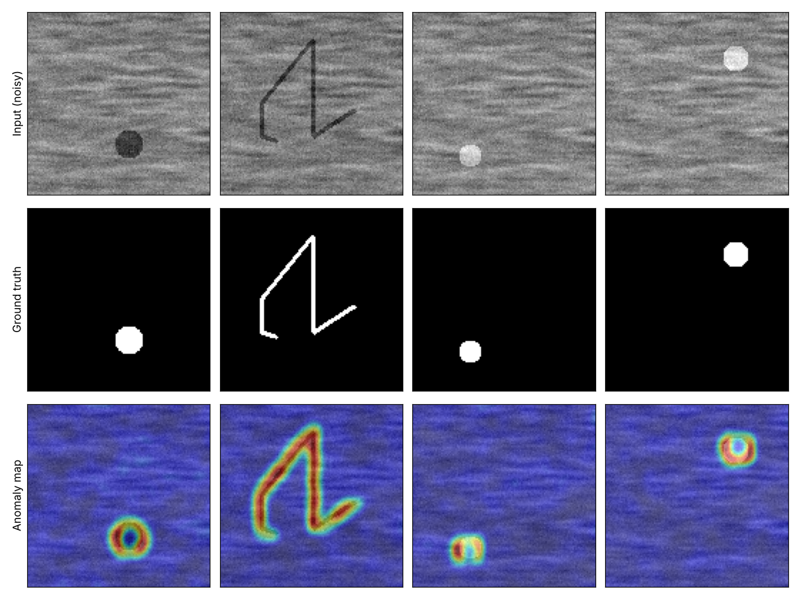
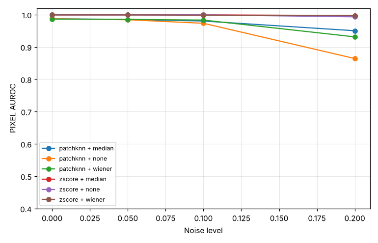

# Noisy Defect Detection

Unsupervised surface-defect detection that stays reliable when the camera is noisy.
The pipeline uses **SciPy** to denoise images and **anomaly detection** to find scratches, cracks and dents,
and it measures how much accuracy drops as noise increases.



## Why

On a real inspection line you rarely have labeled defects, but you have lots of images of good parts.
Both detectors here train **only on defect-free images** and flag whatever doesn't look normal.

## Pipeline

```
images ──► add noise ──► denoise (SciPy) ──► anomaly detector ──► anomaly map ──► AUROC / defect mask
           gaussian       median_filter       TemplateZScore
           salt&pepper    gaussian_filter     PatchKNN (PatchCore-style)
                          signal.wiener
```

| Module | What it does |
|---|---|
| `ndd/data.py` | Loads MVTec AD categories, or generates a synthetic textured-surface dataset |
| `ndd/noise.py` | Gaussian and salt-and-pepper noise |
| `ndd/denoise.py` | `scipy.ndimage` / `scipy.signal` filters, plus PSNR and SSIM |
| `ndd/detectors.py` | **TemplateZScore**: per-pixel mean/std template and z-score.<br>**PatchKNN**: k-NN distance to a memory bank of normal patches (simplified PatchCore).<br>`segment()`: threshold, morphological opening (`binary_opening`) and connected components (`ndimage.label`) |
| `ndd/evaluate.py` | Image-level and pixel-level ROC-AUC |
| `main.py` | Runs every combination of noise level, denoiser and detector, then writes a CSV and plots |

## Quick start

```bash
pip install -r requirements.txt
python main.py                 # synthetic data, about 1 minute on CPU, no download needed
pytest -q                      # tests
```

### On MVTec AD

Download [MVTec AD](https://www.mvtec.com/company/research/datasets/mvtec-ad) (free for non-commercial use) into `data/mvtec/`, then run:

```bash
python main.py --data mvtec --root data/mvtec --category screw --size 128
python main.py --data mvtec --category carpet --noise saltpepper --levels 0 0.02 0.05 0.1
```

## Results

Results on the synthetic dataset (Gaussian noise; `results/results.csv` has the full table):

| Noise σ | Detector | Denoiser | Image AUROC | Pixel AUROC |
|---|---|---|---|---|
| 0.00 | zscore | none | 1.000 | 0.999 |
| 0.00 | patchknn | none | 1.000 | 0.987 |
| 0.20 | zscore | none | 1.000 | 0.993 |
| 0.20 | patchknn | none | 0.904 | 0.864 |
| 0.20 | patchknn | **median** | **0.944** | **0.950** |
| 0.20 | patchknn | wiener | 0.899 | 0.931 |



**Takeaways**
- Denoising matters most for the patch-based detector at high noise. With a median filter, pixel AUROC goes from 0.86 to 0.95 at σ = 0.2.
- The Wiener filter gives the best PSNR at high noise, but the median filter gives better *detection*. Better image quality does not always mean better downstream accuracy.

**Limitations (what didn't work)**
- The synthetic parts are perfectly aligned, which is why the z-score template looks unrealistically strong. On MVTec categories where parts move or rotate (`screw`, `metal_nut`), a pixel-aligned template should break down. Running that comparison is the main point of the MVTec experiment.
- PatchKNN subtracts each patch's mean brightness, so a patch completely inside a large uniform blob looks normal. The detector only fires on blob **edges** (the ring shapes in the image above). Learned CNN features would fix this.

## Next steps
- [ ] Run on 2–3 MVTec categories and fill in the results table
- [ ] Replace raw-pixel patches with pretrained ResNet features (real PatchCore)
- [ ] Greedy coreset sampling instead of random memory-bank subsampling
- [ ] Isolation Forest detector for comparison
- [ ] Streamlit demo: upload an image and get a heatmap
